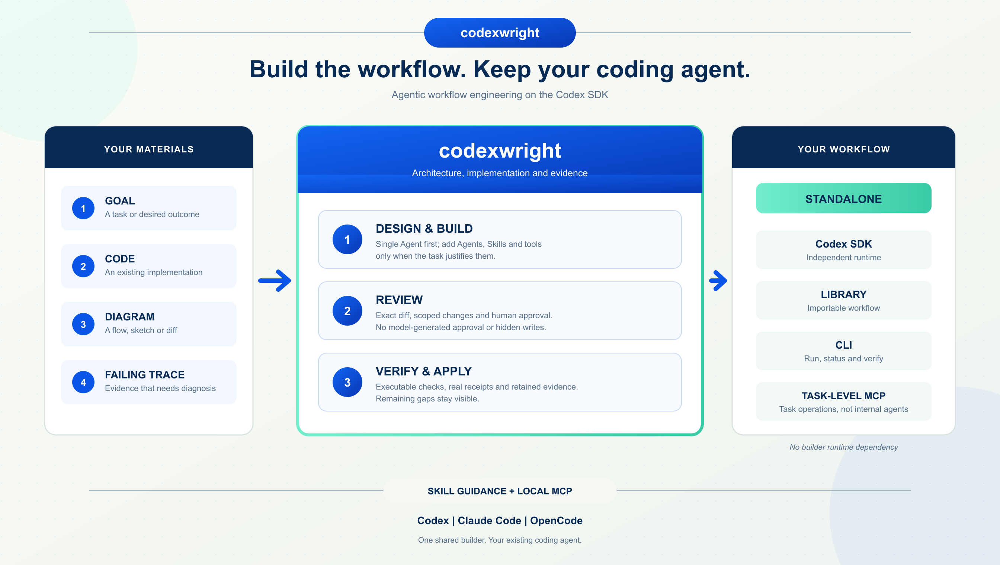

# codexwright



### Build the workflow. Keep your coding agent.

**Design, build, and evolve agentic workflows with the Codex SDK, from the coding agent you already use.**

Bring a goal, a diagram, a failing trace, or an existing implementation. codexwright decides what should be an Agent, a Skill, a tool, or ordinary code, then turns those decisions into a runnable, verifiable system on the **Codex SDK**.

Use it inside **Codex, Claude Code, or OpenCode**, or through an MCP client in your automation. Start from nothing, improve a working system, or rebuild a workflow from another framework. You do not have to start over just to ask for help.

codexwright is a workflow engineering assistant, delivered through **Skill guidance + a local MCP service**. There is no builder CLI or lifecycle Hook. It helps you create or change your own workflow; it does not require a fixed Agent team or a new coding environment.

`0.5.0` · Codex SDK/runtime `0.167.0` · [Rename and migration](docs/codexwright-migration.md) · [0.4.1 historical feedback](docs/mcp-0.4.1-feedback.md)

## What's New In 0.5.0

- **One identity:** the distribution, Python package, plugin, Skills, MCP server, tools and resources now use `codexwright`.
- **Explicit upgrade path:** use `python -m codexwright.mcp_server`, `codexwright_*` tools and `CODEXWRIGHT_*` environment variables. Earlier releases used different public identifiers.
- **State continuity:** existing state remains available through legacy directory and environment fallbacks; new installations default to `~/.local/share/codexwright`.
- **Historical evidence unchanged:** 0.2–0.4 acceptance records retain the names and results that were actually tested.

## What's New In 0.4.1

- **Readable materials:** full selected text is frozen in a private indexed directory with source/content hashes. Bounded previews reduce duplicated context; availability does not claim complete model review.
- **Full conclusions without inventories:** the result-reading tool pages the full operation result by run ID. Original `runs`, proposal diffs and audit records remain intact.
- **Earlier scope feedback:** registration and workspace preflight validate snapshot limits, report file/byte counts and reject oversized scopes before model work.
- **Separate usage and progress signals:** observed inference calls, SDK turns and input/cache/output tokens are distinct. Request progress tokens are separate from service notification/status/event support; no billing or production speed claim is implied.

## Historical 0.4.0 Acceptance

- **One MCP service, thin Skills:** nine tools by default, ten when approval-gated
  application is exposed. No builder CLI, hooks, or replacement coding client.
- **Self-describing contracts:** every tool has a description and input/output
  schemas. Public apply accepts only a proposal ID and a stable request key.
- **Safe retries:** an identical apply request returns its original result without
  another approval, check, or write. Interrupted outcomes stay explicit.
- **Less context, more evidence:** ordinary responses fit within 16 KiB, including
  text and structured representations. Full records, diffs, specs, and events
  remain available through paginated reads.
- **Visible work:** request-scoped stage feedback, retained run IDs, cancellation
  handling, and recovery; no promise of background execution after disconnect.

At the 0.4.0 checkpoint, source and independently installed-wheel suites each passed **164 tests + 6
example subtests**. Real SDK planning and a single-Agent candidate build are
recorded alongside failed editing trials; this is not a production success-rate
claim. See [Current Acceptance](#current-acceptance) before relying on a host's
approval or login UI.

## Product Positioning

**The product is the ability to engineer an Agent system, not a particular Agent count, framework template, or packaging format.**

- **At any project stage:** call codexwright to inspect, design, build, edit, diagnose, migrate, refactor, or verify a workflow.
- **From your available material:** start with a goal, existing code, a document, an image, a diff, a trace, or selected task context; no complete specification is required upfront.
- **Use the smallest sufficient architecture:** choose one Agent when enough, multiple Agents when justified, reusable Skills for procedures, and deterministic tools or ordinary code where they fit.
- **Keep your host:** Skill guidance, MCP, and thin plugins make the same capability available from Codex, Claude Code, OpenCode, or automation.
- **Own the result:** receive a standalone Codex SDK workflow and scoped, reviewable changes with verification evidence, not only design advice.

The current release uses Codex SDK for both construction and the target Agent runtime. An existing Codex SDK system is reused; a system built on another Agent runtime is migrated or rebuilt. Broad input support and flexible host integration do not imply an interchangeable target-runtime abstraction.

See [Product positioning and boundaries](docs/product-positioning.md) for the full definition and the distinction between product direction and currently implemented service forms.

## What You Can Do

| You bring | codexwright helps you |
| --- | --- |
| A rough goal or task-flow description | Choose the smallest useful architecture and build it |
| Code, documents, images, or a diagram | Recover the actual flow and produce an executable spec |
| A simple script or another Agent framework | Capture behavior, then rebuild on Codex SDK |
| An existing Codex SDK workflow | Reuse its runtime and make a scoped change |
| A diff, failing test, or execution trace | Diagnose the failing boundary and prepare a repair |
| An overcomplicated MAS | Compare against a single-Agent baseline and refactor |
| A prepared change | Inspect the exact diff, approve it, apply it, and verify it |

The same service handles analysis, planning, construction, migration, editing, diagnosis, refactoring, and verification. Follow-up requests retain the session and its versioned architecture.

## Two Services, One Clear Boundary

**codexwright is the builder. Your generated workflow is the product it builds.** Neither is limited to a Skill.

```text
Your Codex / Claude Code / OpenCode / MCP client
                     |
             Skill-guided stdio MCP
                     |
                 codexwright
          architecture -> staged proposal
                     |
            exact review + approval
                     |
              standalone workflow
            library / CLI / task-level MCP
                     |
                 Codex SDK
```

- **Builder:** one shared construction service exposed through stdio MCP, with thin Skill/host adapters. Skills guide discovery and invocation, not implementation. The builder has no terminal operation commands.
- **Generated workflow:** a standalone Codex SDK package with library, `mas` CLI, and task-level MCP entrypoints. It does not import codexwright at runtime.
- **Optional target delivery:** plugins, HTTP endpoints, and resident workers can be requested. They are not default scaffold outputs or prebuilt hosting products in this release.
- **Host independence:** Claude Code and OpenCode invoke the same builder; their model/runtime does not replace Codex SDK inside the builder or target.

The target need not already have Codex SDK. The builder has its own isolated installation. Existing Codex SDK implementations are reused; other Agent runtimes are migrated or rebuilt with explicit behavior-preservation criteria.

## Quick Start

Install from source. This repository does not yet publish a PyPI release.

```sh
git clone https://github.com/Jack-mi/codexwright.git codexwright
cd codexwright
python3 scripts/bootstrap.py
codex plugin marketplace add "$PWD"
codex plugin add codexwright@codexwright-local
```

The current implementation requires Python 3.10+. The bootstrap installs the builder into `~/.local/share/codexwright/venv`, using `uv` when available or standard `venv`/`pip`. It does not install dependencies into your target project. For a custom location, pass `--environment` and use the private interpreter printed by the installer. Installation scripts remain; the earlier operation executables have been removed.

In your coding-agent chat, ask the codexwright Skill to check `codexwright_preflight`, register your chosen project and prepare a proposal. If authentication is missing, `codexwright_login` opens a user-only URL elicitation flow; the user signs in outside model context. `device=true` uses a device-code flow displayed only to the user. A client without URL elicitation cannot start an approved login. Existing selected Codex provider configuration/auth can be imported into a private runtime; codexwright never copies your entire `.codex` directory or asks for credentials in a prompt. Model availability depends on your account.

### Build, Review, Apply

The Skill performs the following MCP calls. These are tool arguments, not shell commands. Substitute the returned IDs:

```text
codexwright_preflight({})
codexwright_register({"path": "/absolute/selected/project"})
codexwright_invoke({"envelope": {
  "workspace_id": "ws_RETURNED_ID",
  "goal": "Build a ticket-triage workflow. Use one Agent if sufficient.",
  "operation": "build",
  "idempotency_key": "triage-v1"
}})
```

The response supplies session, run, and proposal IDs. Read every page of the diff, then request user-approved application:

```text
codexwright_read({"category": "proposals", "reference": "prop_RETURNED_ID", "limit": 50000})
codexwright_apply({"request": {"proposal_id": "prop_RETURNED_ID", "idempotency_key": "apply-v1"}})
codexwright_verify({"workspace_id": "ws_RETURNED_ID", "session_id": "ses_RETURNED_ID"})
```

**`invoke` prepares changes; only `apply` writes target files.** Review every page using the returned `next_offset`. Application presents all diff pages through MCP form elicitation and requires final human approval, bound to the exact proposal hash, revision and workspace snapshot. The agent cannot approve for the user. Missing approval support stops application without changing target files; no CLI or Hook bypass exists.

Offline checks run before approval. The approved candidate must pass its live checks and any required independent review before application. The applied files are checked again. Failed gates retain the candidate and evidence instead of claiming completion.

### Continue Anywhere In The Lifecycle

```text
codexwright_invoke({"envelope": {
  "workspace_id": "ws_ID", "session_id": "ses_ID", "operation": "diagnose",
  "goal": "Why did this handoff fail?", "idempotency_key": "diagnose-v1",
  "inputs": [{"kind": "trace", "path": "traces/failed.json", "source": "user"}]
}})
codexwright_invoke({"envelope": {
  "workspace_id": "ws_ID", "session_id": "ses_ID", "operation": "edit",
  "goal": "Fix only the failing adapter; keep the runtime", "idempotency_key": "edit-v1"
}})
codexwright_status({"session_id": "ses_ID"})
codexwright_recover({"run_id": "run_ID"})
```

Set `operation` to `analyze`, `review`, `explain`, or `plan` for inspection/planning; `build`, `edit`, `migrate`, and `refactor` prepare scoped proposals. `auto` chooses the operation from the request. Registration explicitly selects a project without changing it. Recovery checks ownership, original turns, and snapshots; unknown outcomes are not blindly replayed.

## Call It Through MCP

### Current Contract

Every `codexwright_invoke` requires a stable
`envelope.idempotency_key`. `codexwright_apply.request` accepts **only**
`proposal_id` and `idempotency_key`; approval handles, revisions and snapshots
are bound internally after real human confirmation.

- Repeat the exact input and key after a lost response. A completed apply returns
  its original result without another approval, validation run or write.
- `running` means the original operation still owns the workspace. Wait or read
  status/events. `outcome_unknown` means inspect/recover the original run, not
  regenerate or replay effects. Retained declines need a new request/key.
- Results are compact, at most 16 KiB for ordinary summaries. `checks_summary`
  preserves check statuses; `references` locates full details and `omitted`
  counts fields shortened for display. There is no legacy full-output mode.
- `codexwright_read` keeps character offsets, a 12,000-character default and a
  50,000-character maximum. Continue until `next_offset` is null. Its `events`
  category provides the original run's stage log; proposal pages show the frozen
  diff and approval scope rather than a workspace inventory. The `results`
  category pages complete conclusions/checks/assumptions without private input
  or baseline inventories; `runs` still returns the original record.
- Optional progress notifications carry stage sequence and run ID, not invented
  percentages or internal reasoning. This release runs work inside the tool
  request; disconnect does not promise background completion. Cancellation is a
  request to stop owned work, not proof of rollback.

Old MCP clients use elicitation callbacks; `2026-07-28` clients use multi-round
requests with SDK-protected continuation state. Every diff page must be reviewed,
with final approval on the last page. Server restart invalidates unfinished
confirmation; start from page one with a new key. A client's confirmation-round
limit must accommodate the entire diff; exceeding it never authorizes a write.

`preflight.capabilities` separates runtime readiness from apply exposure and
declared form/URL/progress support. Declaration is not proof of a real human
approval UI. Clients without form confirmation can inspect and prepare proposals,
but cannot apply. Existing authentication does not require a new login UI.
Tool-list freshness uses a private five-minute cache hint on modern clients;
dynamic resources remain uncached. Discovery caching does not eliminate model
context costs.

Registration returns `workspace` file/byte counts and limits. Oversized scopes
fail with partial observed counts and the first over-limit path, before model
work. Recheck changed workspaces with preflight. Selected material text is frozen
under `_codexwright_inputs/index.json`; `material_coverage` distinguishes complete
availability from inline previews and leaves actual review unmeasured. `usage`
separates turns, observed inference calls, input/cached/uncached/output tokens
and missing usage. Pass the MCP client's progress callback/token on invoke;
`progress:false` describes only the current request. Status/event reads do not
require notification support. None of these counters establish a bill.

See [upgrade and acceptance](docs/mcp-0.4-acceptance.md) for compatibility changes,
test evidence and the current host matrix.

```sh
"$HOME/.local/share/codexwright/venv/bin/python" -m codexwright.mcp_server
# Expose approval-gated application when you need it:
CODEXWRIGHT_ALLOW_APPLY=1 "$HOME/.local/share/codexwright/venv/bin/python" -m codexwright.mcp_server
```

| Tool | Purpose |
| --- | --- |
| `codexwright_preflight` | Check SDK/runtime, account, and optional workspace readiness |
| `codexwright_register` | Register a user-selected absolute project directory |
| `codexwright_import` | Import a selected local attachment into private workspace assets |
| `codexwright_login` | User-completed authentication through secure URL elicitation |
| `codexwright_recover` | Reconcile an original run and recover its retained candidate |
| `codexwright_invoke` | Analyze or prepare a workflow change from an IntakeEnvelope |
| `codexwright_verify` | Run the saved architecture's verification checks |
| `codexwright_status` | Inspect a session or run |
| `codexwright_read` | Read specs, exact proposal diffs, and bounded evidence pages |
| `codexwright_apply` | Apply an exact human-approved proposal; exposed only with `CODEXWRIGHT_ALLOW_APPLY=1` |

Register the target with `codexwright_register` and pass its `workspace_id` to invoke/import/verify. All builder lifecycle operations are available through this one server. `status/read` are ordinary tools, so basic use does not depend on MCP Resources support.

Use the **actual absolute interpreter path printed by bootstrap** in your client's MCP configuration, rather than assuming an interactive-shell PATH:

```json
{
  "mcpServers": {
    "codexwright": {
      "command": "/absolute/path/from/bootstrap/bin/python",
      "args": ["-m", "codexwright.mcp_server"],
      "env": {"CODEXWRIGHT_ALLOW_APPLY": "1"}
    }
  }
}
```

`CODEXWRIGHT_HOME` selects private builder state and `CODEXWRIGHT_MODEL` optionally selects the model. `CODEXWRIGHT_ALLOW_APPLY` only exposes application; it never grants user approval. MCP application uses real human form elicitation; rejected, changed, expired, or consumed approvals cannot be bypassed through another adapter. Authentication separately requires URL elicitation. Clients without those capabilities can still use the other tools.

## Bring Your Own Coding Agent

The supported host delivery is Skill guidance + MCP, with no lifecycle Hook. An MCP client can also call the server without a Skill; the Skill supplies procedural guidance rather than executing the builder.

| Host | Integration |
| --- | --- |
| Codex | Compact local plugin in `adapters/codex`, with Skill + MCP launcher |
| Claude Code | Session plugin in `adapters/claude-code`, invoking the same private builder |
| OpenCode V2 | MCP configuration + instructions in `adapters/opencode` |
| Automation | Any stdio MCP client using the private interpreter |

These are integration adapters, not identical commissioning claims. The current
Codex plugin's real preflight/registration path is verified; current Claude Code
and OpenCode commissioning, and real human approval/new-login UI across hosts,
remain pending. Consult [the acceptance matrix](docs/mcp-0.4-acceptance.md#host-support-matrix).

```sh
# From this repository, after installing the builder:
codex plugin marketplace add "$PWD"
codex plugin add codexwright@codexwright-local

# Or a session-only Claude Code adapter:
claude --plugin-dir "$PWD/adapters/claude-code"
```

For OpenCode V2, merge `adapters/opencode/opencode.jsonc` into your chosen project configuration and include its `codexwright-host.md` instructions. Replace its `python` command with the installed absolute private interpreter. No separate JavaScript Agent runtime or UI plugin is needed.

Adapters do not rewrite global host settings. `CODEXWRIGHT_ENV` or `CODEXWRIGHT_PYTHON` selects a custom private builder for plugin launchers. Actual host loading and same-fixture calls are recorded in the acceptance evidence; this is not a claim about every future host version.

## Architecture That Can Be Checked

The versioned **ArchitectureSpec** is the executable contract, not just a diagram:

- **Single-Agent first:** `single_agent_sufficient` requires exactly one Agent. Multiple Agents need a reason and baseline comparison, not a fixed team template.
- **Explicit work packets:** typed input/output, dependencies, conditions, assertions, and integration rules; the host owns the scheduler and stopping conditions.
- **Skills where they belong:** reusable procedures are loaded through public `SkillInput`. Generation, discovery, loading, and asserted behavior have distinct evidence.
- **Narrow tools:** bounded `read_file`/`list_files`, Python CLI modules, and project-local Python stdio MCP servers run through a host-owned registry with schemas, OS sandbox, timeout, output limits, and actual call receipts. General shell is not a builtin tool.
- **Controls outside the model:** scope, budgets, concurrency, retries, snapshots, approval, and verification are enforced by code. A model verdict alone cannot make a failed run pass.

Codex SDK supplies threads, turns, structured results, and runtime capabilities. codexwright supplies workflow architecture, lifecycle, orchestration, and verification. The SDK is not the same thing as an interactive Codex client, and codexwright does not invent SDK methods such as `create_agent` or `register_tool`.

## Inputs Without A Forced Form

Pass an IntakeEnvelope with selected `inputs` of kind `file`, `image`, `url`, `diff`, `trace`, or `conversation`. Code, diffs, traces, failures, and selected conversation are provenance-labelled references, not execution authority. Full host chats are not copied automatically.

```text
codexwright_import({"workspace_id": "ws_ID", "path": "/absolute/selected/architecture.docx"})
codexwright_invoke({"envelope": {
  "workspace_id": "ws_ID", "goal": "Build from these notes",
  "idempotency_key": "notes-build-v1",
  "inputs": [{"kind": "file", "asset_id": "asset_RETURNED_ID", "source": "user"}]
}})
```

Local images enter supported SDK turns. DOCX uses bounded XML extraction; PDF uses sandboxed `pdftotext` or user-supplied extracted text/page images. Public HTTP(S) references are bounded, pin validated public addresses, and reject redirects, credentials, and private destinations. This does not imply native SDK support for every file type.

## Your Workflow Runs Independently

Install the generated project into its own environment:

```sh
python3 -m venv .venv
.venv/bin/python -m pip install .
.venv/bin/mas run --input request.json
.venv/bin/mas status --run-id latest
.venv/bin/mas verify --run-id latest
.venv/bin/mas serve
```

The generated MCP exposes `mas_run`, `mas_status`, `mas_read`, and `mas_verify` at the **task level**, not one public service per internal Agent. Its run state defaults outside the installed package, under `$XDG_STATE_HOME/codex-workflows` or `~/.local/state/codex-workflows`; use `--state-dir` or `WORKFLOW_STATE_DIR` to override it. Checkpoints bind the exact spec and input.

CI means **continuous integration**: an automated environment that reruns commands/tests when code changes. It can call your generated workflow's CLI or a codexwright MCP client; it is not another Agent or a mandatory service form. Unattended CI cannot fabricate the human approval required to apply a builder proposal.

## Current Acceptance

For 0.5.0, source and independent installed-wheel suites each pass **180 tests,
one skipped test, and six example subtests**. The clean wheel contains only the
`codexwright` package. An independent stdio client discovers all ten
`codexwright_*` tools and both `codexwright://` resource templates; bootstrap
and launcher checks also pass. See [0.5.0 rename evidence](docs/acceptance-evidence/codexwright-0.5-rename.json).
Fresh host UI commissioning and live model behavior were not repeated for this
identifier-only migration.

For historical 0.4.1, source and independent installed-wheel suites each pass **178 tests
plus six example subtests**. The known PNG/UTF-8 portability baseline failure is
explicitly excluded; the live SDK case runs separately. Real installed retrieval
reads a 220,043-character attachment's hidden tail, receives 14 progress
notifications and leaves its target unchanged. The local plugin is refreshed;
a fresh Codex host reports the new capability fields. Same-material context
bytes shrink by 83.45%, not a claimed token/cost/quality improvement. See
[0.4.1 evidence and limitations](docs/mcp-0.4.1-feedback.md).

The following table preserves the distinct historical 0.4.0 commissioning scope.

| Check | Observed result in 0.4.0 |
| --- | --- |
| Regression and installation | 164 tests + 6 example subtests pass in source and independent installed-wheel environments; no builder CLI or console entrypoints |
| Codex host | Installed local plugin loads; real ephemeral host preflight and registration succeed without target changes |
| SDK lifecycle inputs | Read-only explanation, new single-Agent planning, existing-SDK analysis, and other-framework migration planning complete with explicit model selection |
| Candidate construction | One real single-Agent build produces a reviewable proposal; six offline checks pass, live verification remains approval-gated |
| Editing reliability | Two fresh scoped-edit trials fail: zero tests discovered, then an empty proposal. Neither is applied or relabelled successful |
| Protocol and controls | Legacy/modern stdio, paged confirmation, tampered-state rejection, replay/concurrency, bounded output, and cancellation have automated coverage |
| Human interaction | Actual user-completed approval and new identity login remain uncommissioned; test callbacks are not human authorization |

The default CatPaw IDE backend in the recorded local environment rejected a
structured-output parameter. A separate process-local `CODEXWRIGHT_MODEL` selection
completed the SDK explanation trial; no global model/provider configuration was
changed. Account/model-catalog readiness alone does not prove the selected model
supports every required operation. Choose a compatible configured model and keep
failed verification visible rather than weakening the contract.

Detailed receipts and scope are in [0.4.0 acceptance](docs/mcp-0.4-acceptance.md)
and [the evidence manifest](docs/acceptance-evidence/mcp-0.4-manifest.json).

## Safety, Evidence, And Honest Limits

| Boundary | Current behavior |
| --- | --- |
| Target writes | Exact proposal, scope, revision, snapshot, and one-use approval |
| Generated SDK configuration | Private `CODEX_HOME`; no inherited global MCP, plugins, or project trust |
| Project code execution | OS-sandboxed checks/tools; no environment-controlled sandbox bypass |
| Live generated checks | Execute verified package-owned templates; user tool implementations remain separately sandboxed |
| Existing-project verification | Use the owning project's local venv, or a portable explicit `verification.python` path; no automatic dependency install |
| Unknown / interrupted outcomes | Retained and reconciled; never automatically replayed as success |
| Builder state | Private state outside the target, default `~/.local/share/codexwright` or `CODEXWRIGHT_HOME` |
| Public evidence | Redacted command/results, hashes, and scoped trials; no credentials, provider config, or raw reasoning |

`completed` is distinct from verification `passed`. `approval_required`, `pending_live`, `partial`, `failed`, `blocked`, and `outcome_unknown` remain visible in structured MCP results. No builder operation exit-code interface is installed.

macOS is the commissioned local runtime platform, within the scope described above. Linux bubblewrap support exists but end-to-end Linux commissioning is unverified; Windows verification fails closed. Remote HTTPS model checks use a request-scoped pinned CONNECT relay, but actual remote-model end-to-end remains unverified in the tested routed environment. Successful model turns do not resolve an account preflight timeout: `codexwright_preflight` can truthfully report `account_unverified` even when a separate task works.

Generation is stochastic and budgeted. Local tests, a tiny holdout, and captured migration contracts do not establish production reliability or original-runtime parity when the old framework could not be executed. External/destructive tools, multi-user hosting, automatic deployment, remote HTTP hosting, and resident workers are not enabled products in this release. State retention is manual.

The source is intended for public development. **No license has been selected yet**; do not assume a permissive open-source license, a PyPI release, or a published host marketplace package.

## Commercialization Is A Plan, Not A Deployment

See [Commercialization plan](docs/commercialization-plan.md) for proposed remote authentication, tenant isolation, task-based entitlements, metering, billing reconciliation and rollout gates. This change implements none of the payment, remote hosting or multi-tenant features. Local MCP capability is not production SaaS acceptance.

## Upgrading To 0.5.0

Follow the [rename and migration guide](docs/codexwright-migration.md). Re-run bootstrap, install the `codexwright` plugin, replace earlier tool names with `codexwright_*`, and reconnect the MCP client. Existing state remains available through the legacy-state fallback.

## Upgrading To 0.4.0

Re-run bootstrap in the same private environment, refresh your local plugin, then
start a new chat or reconnect MCP to reload tool metadata. Existing state,
workspaces, sessions, candidates, and backups are retained.

From **0.3.0**, update callers to supply an `idempotency_key` for every invoke.
Apply accepts only `proposal_id` and `idempotency_key`; do not send internal
approval fields. Default results are summaries: fetch details via their
`references`, continue `read` until `next_offset` is null, and check `verification`
separately from operation status. There is no legacy full-output mode. Restarted
or expired reviews require a new key and complete human confirmation from page one.

### From 0.2.0

Re-run bootstrap in the same private environment, refresh the local plugin, and start a new chat or reconnect MCP. Replace any custom pre-0.4.0 serve configuration with the private interpreter plus the current MCP module; plugin launchers now take no operation arguments. Existing state, workspaces, sessions and proposal records are retained. Use the four MCP tools for registration, import, authentication and recovery. Generated workflows and their `mas` CLI are unchanged. Historical acceptance evidence remains labelled `0.2.0`, not rewritten as current-release proof.

## Development

```sh
python3 -m venv .venv
.venv/bin/python -m pip install -e . pytest build
.venv/bin/pytest -q tests examples
.venv/bin/python scripts/export_schemas.py
.venv/bin/python -m build --wheel
```

| Start here | What it contains |
| --- | --- |
| [Product positioning](docs/product-positioning.md) | Core value, lifecycle, host integration, target output, and scope |
| [Architecture blueprint](docs/codexwright-blueprint.md) | Product boundaries, SDK mapping, contracts, lifecycle |
| [0.5.0 rename and migration](docs/codexwright-migration.md) | New identifiers, installation changes and state compatibility |
| [0.5.0 rename evidence](docs/acceptance-evidence/codexwright-0.5-rename.json) | Source/wheel tests, MCP discovery, bootstrap and asset checks |
| [Implementation ledger](docs/implementation-status.md) | Observed behavior, historical trials, remaining gaps |
| [0.4.0 acceptance](docs/mcp-0.4-acceptance.md) | Current contracts, installation/SDK receipts, failed trials, and host matrix |
| [Historical acceptance](docs/acceptance-report.md) | Earlier requirement mapping and measured local scope |
| [Release fix ledger](docs/release-fixes.md) | Review findings and their regression evidence |
| [Reference evaluations](docs/project-evaluations.md) | Architecture comparisons without universal MAS claims |
| `src/codexwright/schemas` | Exported public request/spec/result schemas |
| `examples/minimal_mas.py` | A read-only two-role teaching example, not the service runtime |

SDK-specific APIs are checked against the public pinned release and [official Codex SDK documentation](https://learn.chatgpt.com/docs/codex-sdk). Architecture decisions use [agents-best-practices](https://github.com/DenisSergeevitch/agents-best-practices); approval interactions apply the relevant [RICH confirmation guidance](https://github.com/ant-design/x/blob/8b76d6a22067945c5d224c02ee1448dfb30144ff/packages/x/docs/spec/confirm.zh-CN.md). Host/API references and verified revisions are recorded in the blueprint and ledger.
