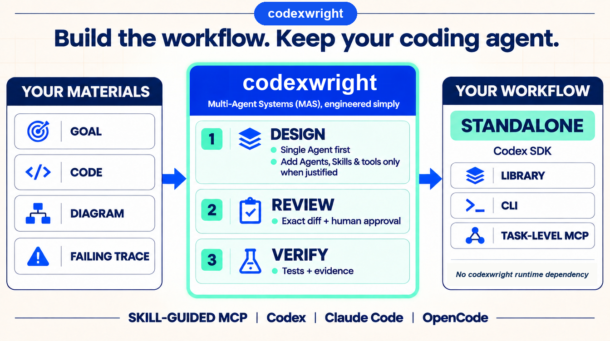

# codexwright X / Hacker News drafts

Based on local `main` at `d9c21cf` (`0.4.0`), reviewed on 2026-11-09.
These are drafts only; nothing has been posted.

## Product-logic infographic



Attach `codexwright-product-logic.png` to X1. The same image appears near the top
of the README for Hacker News visitors. It explains MAS without implying that
every workflow needs multiple Agents.

Suggested social alt text:

> Diagram showing goals, code, diagrams, and failing traces flowing into
> codexwright for single-Agent-first design, exact-diff human review, and
> verification, then producing a standalone Codex SDK workflow with library,
> CLI, and task-level MCP interfaces.

## Positioning

Core message:

> Build the workflow. Keep your coding agent.

codexwright is a workflow engineering assistant for Codex SDK, not a fixed
multi-agent team generator. Its strongest differentiators are:

- Start from a goal, existing code, documents, images, diffs, or failing traces.
- Prefer one Agent; add Skills, tools, or Agents only when justified.
- Review an exact proposal before `apply` can write target files.
- Produce a standalone Codex SDK workflow and verification evidence.
- Invoke the same builder through Skill-guided MCP from Codex, Claude Code, or OpenCode.

Do not call it production-proven, PyPI-published, hosted, or open-source. The
repository is public, but no license has been selected. Current acceptance is
local macOS acceptance, not a production reliability benchmark.

## X series

Post these separately rather than all at once. Each stands alone; the launch,
standalone-output, and feedback posts are the best starting set.

### X1 - Launch

Attach `codexwright-product-logic.png`.

```text
I built codexwright 🚀 Engineer multi-agent systems (MAS) from your coding agent.

Goals, code, or traces -> Codex SDK workflows. Single-Agent first; multi-Agent when justified. Exact diffs, human approval, verification ✅

Skill-guided MCP 🧩

https://github.com/Jack-mi/codexwright
```

### X2 - Single-Agent first

```text
🤖 Multi-agent should be justified architecture, not the default template.

🧠 codexwright starts with one Agent. It adds Skills, tools, or more Agents only when the task needs them, and asks for a baseline comparison before adding complexity.

https://github.com/Jack-mi/codexwright
```

### X3 - Approval boundary

```text
🛠️ Agent builders often stop at scaffolding.

codexwright separates:
- 🔎 invoke: analyze and stage a proposal
- 📖 read: inspect the exact diff
- ✅ apply: write after approval
- 🧪 verify: check the applied result

A model saying "done" is not the acceptance gate 🚫
```

### X4 - Improve an existing system

```text
🔧 You shouldn't have to rebuild your agent system just to improve it.

📦 codexwright can start from existing code, a diff, a trace, or a failed test. Existing Codex SDK systems are edited in scope; other runtimes are migrated with explicit behavior criteria.
```

### X5 - Standalone output

```text
📦 What does codexwright produce?

🧩 A standalone Codex SDK workflow with library, CLI, and task-level MCP entrypoints. It does not import codexwright at runtime.

The builder is the tool. Your workflow is the product 🚀

https://github.com/Jack-mi/codexwright
```

### X6 - Keep your host

```text
💻 Keep the coding agent you already use.

🔌 codexwright exposes one builder through stdio MCP, guided by thin Skills and adapters for Codex, Claude Code, and OpenCode. No builder CLI, no lifecycle Hooks, no replacement coding client.
```

### X7 - Controls outside the model

```text
🛡️ Agent workflow controls belong outside the model.

⚙️ codexwright uses typed work packets, scoped tools, budgets, retries, snapshots, one-use approvals, and verification. Failed, partial, blocked, and unknown outcomes stay visible.
```

### X8 - Transparent release status

```text
🚀 codexwright 0.4.0 is public for feedback.

✅ macOS acceptance: 164 tests + 6 example subtests pass in source and installed-wheel suites.

⚠️ No PyPI or license yet. Host approval/login UI and production reliability remain unverified.

https://github.com/Jack-mi/codexwright
```

### X9 - Feedback

```text
🤔 What is the most painful part of building agent workflows today?

1. Choosing the architecture
2. Integrating tools and Skills
3. Debugging handoffs
4. Verifying that the result actually works

I'm building codexwright around these problems:
https://github.com/Jack-mi/codexwright
```

## Hacker News

Use one Show HN submission, not a sequence of near-duplicate launches. The
alternative titles are options for the same submission, not separate posts.

### Recommended title

```text
Show HN: Codexwright, an approval-gated Codex SDK workflow builder
```

URL:

```text
https://github.com/Jack-mi/codexwright
```

### Alternative titles

```text
Show HN: Codexwright, single-Agent-first workflow engineering for Codex SDK
Show HN: Codexwright, build and verify Agent workflows from your coding agent
```

### First comment

```text
Hi HN - I built codexwright because I wanted help engineering Agent workflows without adopting another fixed multi-agent framework.

It accepts a goal, existing code, documents/images, a diff, or a failing trace. It chooses one Agent by default, adds Skills/tools/Agents only when justified, and stages an exact proposal. Nothing writes to the target until the proposal is reviewed and approved.

The result is a standalone Codex SDK package with library, CLI, and task-level MCP interfaces. It does not import codexwright at runtime. The builder itself is available through stdio MCP, with thin Skills and adapters for Codex, Claude Code, and OpenCode. There is no builder CLI or lifecycle Hook.

Current acceptance includes real SDK planning and one single-Agent candidate build. Source and installed-wheel suites each pass 164 tests + 6 example subtests. Two fresh scoped-edit trials failed safely and remain visible in the ledger. This is local macOS acceptance, not a production reliability claim.

Current limits: real user-completed approval and new-login UI commissioning are pending, remote-model end-to-end remains unverified, and there is no PyPI or hosted release. No license has been selected yet.

I would especially like feedback on the approval/verification model and whether the generated workflow boundary makes sense.
```

### Short answers for likely comments

**Why not just prompt Codex to build the workflow?**

```text
You still use Codex for construction. codexwright adds a persistent architecture contract, lifecycle operations, exact staged diffs, one-use approval, scoped application, and verification evidence around that work. It is aimed at repeated construction and evolution, not replacing the model with templates.
```

**Why is single-Agent-first a feature?**

```text
Extra Agents add handoffs, context, cost, and failure modes. Sometimes independent contexts or verification justify them; often they do not. codexwright makes one Agent the baseline and requires a concrete reason and comparison before adding more.
```

**Does Claude Code or OpenCode replace the Codex runtime?**

```text
No. They are alternative hosts for invoking the same builder. The current builder and generated target workflow both use Codex SDK. Host flexibility is not a provider-neutral runtime abstraction.
```

**Is this a no-code workflow builder?**

```text
No. It is a coding-agent-accessible engineering tool that produces a real Python/Codex SDK project. The point is not to hide code; it is to make architecture, changes, approval, and verification explicit.
```

## Before posting

- Recheck the README if installation, licensing, platform support, or release status changes.
- Post X1 first; use X2-X7 as standalone follow-ups, then X8/X9 when feedback is useful.
- On HN, answer technical questions directly and keep failures and limits visible.
- Do not use the historical single-run latency/token measurements as a general benchmark.
